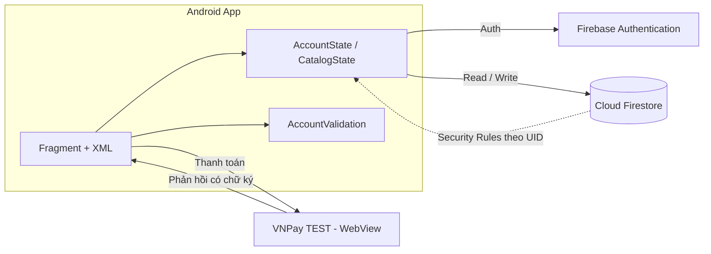

<div align="center">

# TMDT — Tutor Marketplace for Android

**Nền tảng di động kết nối học viên và gia sư — tìm kiếm, đăng ký lớp và thanh toán trong một ứng dụng.**


[Tổng quan](#tổng-quan) · [Kiến trúc](#kiến-trúc) · [Bắt đầu nhanh](#bắt-đầu-nhanh) · [Cấu hình](#cấu-hình-môi-trường) · [Quy trình phát triển](#quy-trình-phát-triển) · [Kiểm thử](#kiểm-thử) · [Xử lý sự cố](#xử-lý-sự-cố)

</div>

---

## Mục lục

1. [Tổng quan](#tổng-quan)
2. [Phạm vi phiên bản hiện tại](#phạm-vi-phiên-bản-hiện-tại)
3. [Kiến trúc](#kiến-trúc)
4. [Bắt đầu nhanh](#bắt-đầu-nhanh)
5. [Cấu hình môi trường](#cấu-hình-môi-trường)
6. [Quy trình phát triển](#quy-trình-phát-triển)
7. [Kiểm thử](#kiểm-thử)
8. [Bảo mật](#bảo-mật)
9. [Xử lý sự cố](#xử-lý-sự-cố)
10. [Lộ trình](#lộ-trình)
11. [Tài liệu](#tài-liệu)
12. [Đóng góp và liên hệ](#đóng-góp-và-liên-hệ)

## Tổng quan

TMDT là ứng dụng Android dành cho hai nhóm người dùng: **học viên** tìm gia sư phù hợp và **gia sư** đăng ký mở lớp. Giao diện được triển khai theo thiết kế Figma (`thiết kế giao diện mobile_1.docx`). Cấu trúc dữ liệu được rút gọn từ `03_Thiet_ke_CSDL_v4.md`, chỉ giữ các luồng nghiệp vụ đang được sử dụng.

| Vai trò | Khả năng chính |
| --- | --- |
| Học viên | Tìm kiếm không dấu, lọc theo môn, xem hồ sơ gia sư, quản lý hồ sơ cá nhân, thanh toán học phí |
| Gia sư | Đăng ký hồ sơ gia sư, chờ duyệt, chuyển đổi vai trò, báo hoàn thành buổi học |
| Quản trị viên | Duyệt hồ sơ gia sư, quản lý danh mục gia sư/môn dạy, lập bảng chi trả theo tháng |

## Phạm vi phiên bản hiện tại

| Hạng mục | Mô tả | Trạng thái |
| --- | --- | :---: |
| Xác thực | Email/Password, xác nhận mật khẩu, lưu phiên, quên mật khẩu qua email | ✅ |
| Trang chủ | Banner, tìm kiếm không dấu, lọc môn, danh sách gia sư đồng bộ thời gian thực | ✅ |
| Hồ sơ cá nhân | Thông tin, địa chỉ, số điện thoại, ảnh đại diện, cấp học, mục tiêu | ✅ |
| Đăng ký gia sư | Nhập → xem lại → gửi; hồ sơ `PENDING` chờ duyệt; chuyển đổi vai trò | ✅ |
| Thanh toán | VNPay TEST trong WebView, chỉ ghi nhận khi phản hồi có chữ ký hợp lệ | ✅ |
| Phân quyền dữ liệu | Firestore Rules theo UID, chặn nâng quyền, chặn client sửa danh mục | ✅ |
| Xác thực điện thoại | OTP, chức năng bổ sung | ⚙️ Tùy chọn |
| Lịch học | Màn hình chờ | 🚧 |
| Tin nhắn | Màn hình chờ | 🚧 |

**Luồng thanh toán:** học viên thanh toán đăng ký đã duyệt → VNPay trả kết quả → gia sư báo hoàn thành buổi → học viên xác nhận → quản trị viên lập bảng chi trả tháng.

**Ngoài phạm vi (đã loại bỏ):** tin đăng/ứng tuyển/lời mời, minh chứng bằng cấp, hợp đồng chống dạy ngoài, học thử/điểm danh, đánh giá, cấu hình hệ thống. Xem [FIRESTORE_SCHEMA.md](FIRESTORE_SCHEMA.md).

## Kiến trúc



### Công nghệ

| Lớp | Công nghệ |
| --- | --- |
| Client | Android (Java), Fragment + XML, minSdk Android 10 |
| Build | Gradle (Kotlin DSL), JDK 21 |
| Xác thực | Firebase Authentication |
| Dữ liệu | Cloud Firestore + Security Rules |
| Thanh toán | VNPay TEST |
| Tooling | Firebase Emulator, Node.js scripts |

### Cấu trúc repository

```text
.
├── app/                      Mã nguồn ứng dụng Android
├── email-otp-server/         Máy chủ hỗ trợ gửi OTP qua email
├── scripts/                  Kiểm thử Firebase, kiểm tra cấu hình VNPay
├── signing/                  Cấu hình ký ứng dụng
├── legacy/                   Mã mô phỏng cũ (ngoài source set)
├── firestore.rules           Security Rules
├── firestore.indexes.json    Chỉ mục Firestore
├── firebase.json             Cấu hình Firebase CLI / Emulator
└── vnpay.properties.example  Mẫu cấu hình VNPay
```

### Thành phần chính

| File | Trách nhiệm |
| --- | --- |
| `MainActivity.java` | Host Fragment, điều hướng, kiểm tra đăng nhập |
| `ui/home/HomeFragment.java` | Trang chủ (`fragment_home.xml`) |
| `ui/auth/*.java` | Đăng nhập, đăng ký, quên mật khẩu, OTP |
| `ui/profile/*.java` | Trang cá nhân, chỉnh sửa hồ sơ |
| `CatalogState.java` | Lắng nghe danh mục Firestore, nối môn và học phí |
| `AccountState.java` | Firebase Auth, lưu/tải hồ sơ, xử lý lỗi |
| `UserProfile.java` | Ánh xạ trường dữ liệu |
| `AccountValidation.java` | Kiểm tra và chuẩn hóa đầu vào |

Mỗi màn hình có Fragment và XML riêng — xem [SCREEN_STRUCTURE.md](SCREEN_STRUCTURE.md).

## Bắt đầu nhanh

### Yêu cầu

| Công cụ | Phiên bản |
| --- | --- |
| Android Studio | Bản ổn định mới |
| JDK | 21 |
| Android SDK | Theo cấu hình dự án |
| Thiết bị / máy ảo | Android 10 trở lên |
| Node.js | Dùng cho script kiểm thử |

### Cài đặt

```bash
git clone https://github.com/pvhNam/TMDT_CK.git
cd TMDT_CK
```

1. Mở thư mục bằng Android Studio và đợi Gradle sync.
2. Hoàn tất [cấu hình Firebase](#firebase).
3. Sao chép `vnpay.properties.example` thành `vnpay.properties`, điền thông tin TEST ([xem VNPay](#vnpay-test)).
4. Chọn thiết bị và chạy ứng dụng.

### Build bằng dòng lệnh

```powershell
.\gradlew.bat :app:assembleDebug :app:testDebugUnitTest :app:lintDebug
```

Đầu ra: `app/build/outputs/apk/debug/app-debug.apk`

## Cấu hình môi trường

### Firebase

Project: `tmdt-3e274`

- [ ] Bật **Email/Password** trong Authentication.
- [ ] **Publish Firestore Rules** từ `firestore.rules`.
- [ ] Nhập danh mục gia sư và môn dạy theo [schema](FIRESTORE_SCHEMA.md).

> **Lưu ý:** `google-services.json` chỉ cấu hình ứng dụng, không đồng nghĩa rules đã được publish hoặc phương thức đăng nhập đã được bật trên Console.

Hồ sơ `users/{UID}` được tạo khi đăng ký thành công. Chi tiết: [FIREBASE_SETUP.md](FIREBASE_SETUP.md).

### VNPay TEST

Tạo `vnpay.properties` ở thư mục gốc (cùng cấp `gradlew.bat`):

```properties
VNPAY_TMN_CODE=MA_WEBSITE_TEST
VNPAY_HASH_SECRET=KHOA_CHECKSUM_TEST
VNPAY_RETURN_URL=https://tmdt.example/vnpay/return
```

Kiểm tra cấu hình (không in secret):

```bash
node scripts/check-vnpay-config.mjs
.\gradlew.bat :app:checkVnpayConfig :app:assembleDebug
```

| Nguyên tắc | Nội dung |
| --- | --- |
| Return URL | WebView bắt trực tiếp trong app, không cần website hoạt động ở địa chỉ này |
| Thay đổi cấu hình | Cần build và cài lại ứng dụng |
| Dữ liệu giao dịch | Collection `sandbox_` lưu giao dịch từ cổng TEST, tách khỏi sổ tiền thật |
| Bản release | Không chứa secret TEST, tắt nhánh ký trực tiếp trong app |

Chi tiết: [PAYMENT_SETUP.md](PAYMENT_SETUP.md).

## Quy trình phát triển

> Các quy ước dưới đây là chuẩn làm việc đề xuất cho nhóm; điều chỉnh theo thực tế trước khi áp dụng.

### Nhánh

| Nhánh | Mục đích |
| --- | --- |
| `main` | Luôn ổn định, có thể build và chạy |
| `feature/<tên-ngắn>` | Phát triển tính năng mới |
| `fix/<tên-ngắn>` | Sửa lỗi |
| `docs/<tên-ngắn>` | Cập nhật tài liệu |

### Commit

Theo [Conventional Commits](https://www.conventionalcommits.org/):

```text
feat(auth): thêm kiểm tra mật khẩu xác nhận
fix(home): sửa lọc theo môn khi không dấu
docs(readme): cập nhật hướng dẫn cấu hình VNPay
```

### Pull Request

1. Tạo nhánh từ `main`, giữ thay đổi nhỏ và tập trung vào một mục tiêu.
2. Chạy `:app:testDebugUnitTest` và `:app:lintDebug` trước khi mở PR.
3. Mô tả rõ thay đổi, lý do và cách kiểm tra; đính kèm ảnh chụp màn hình nếu đổi giao diện.
4. Có ít nhất một thành viên review và chấp thuận trước khi merge.
5. Thay đổi `firestore.rules` phải kèm kiểm thử trong `scripts/test-firebase.mjs`.

### Quy ước mã nguồn

- Mỗi màn hình một Fragment và một file XML riêng.
- Kiểm tra và chuẩn hóa đầu vào đặt trong `AccountValidation`, không rải trong Fragment.
- Truy cập dữ liệu và trạng thái tập trung ở lớp `*State`; Fragment chỉ xử lý hiển thị.
- Không thêm dữ liệu giả vào ứng dụng; trạng thái rỗng phải hiển thị đúng là rỗng.

## Kiểm thử

| Loại | Lệnh |
| --- | --- |
| Unit test | `.\gradlew.bat :app:testDebugUnitTest` |
| Lint | `.\gradlew.bat :app:lintDebug` |
| Auth và Rules | Firebase Emulator + `scripts/test-firebase.mjs` |

Script kiểm thử chỉ dùng localhost và **không** ghi dữ liệu lên Firebase thật. OTP/SMS thật và email thật cần cấu hình Console và xác nhận riêng. Lệnh chạy Emulator: [FIREBASE_SETUP.md](FIREBASE_SETUP.md).

## Bảo mật

- Không commit `vnpay.properties`, khóa ký ứng dụng hoặc file chứa secret; các file này đã nằm trong `.gitignore`.
- Firestore Rules trong repository chỉ có hiệu lực sau khi được Publish trên Console.
- Rules bảo vệ hồ sơ theo UID, chặn nâng vai trò và chặn client sửa danh mục gia sư.
- Nếu phát hiện lỗ hổng, vui lòng báo riêng cho chủ repository thay vì mở issue công khai.

## Xử lý sự cố

| Hiện tượng | Nguyên nhân thường gặp | Cách xử lý |
| --- | --- | --- |
| Không đăng nhập/đăng ký được | Chưa bật Email/Password trên Console | Bật trong Firebase Console → Authentication |
| Báo thiếu quyền khi đọc/ghi | Rules chưa được Publish | Publish `firestore.rules` lên Console |
| Trang chủ trống | Database chưa có gia sư/môn dạy | Nhập dữ liệu theo [schema](FIRESTORE_SCHEMA.md) |
| Build báo thiếu cấu hình VNPay | Chưa có `vnpay.properties` | Sao chép từ `vnpay.properties.example` và điền thông tin TEST |
| VNPay trả mã **71** — terminal not approved | Merchant TEST chưa được VNPay duyệt | Liên hệ VNPay kích hoạt; không tự đánh dấu đơn thành công |
| Đổi cấu hình VNPay nhưng không có hiệu lực | App chưa được build lại | Build và cài lại ứng dụng |

## Lộ trình

- [x] Trang chủ, đăng nhập, đăng ký, hồ sơ cá nhân
- [x] Đăng ký làm gia sư và chuyển đổi vai trò
- [x] Thanh toán VNPay TEST
- [ ] Nghiệp vụ **Lịch học**
- [ ] Nghiệp vụ **Tin nhắn**

## Tài liệu

| Tài liệu | Nội dung |
| --- | --- |
| [FIREBASE_SETUP.md](FIREBASE_SETUP.md) | Cấu hình Firebase và Emulator |
| [FIRESTORE_SCHEMA.md](FIRESTORE_SCHEMA.md) | Schema Firestore rút gọn |
| [TUTOR_REGISTRATION.md](TUTOR_REGISTRATION.md) | Luồng đăng ký làm gia sư |
| [FIGMA_MENU.md](FIGMA_MENU.md) | Menu dưới theo Figma |
| [SCREEN_STRUCTURE.md](SCREEN_STRUCTURE.md) | Cấu trúc màn hình và Fragment |
| [PAYMENT_SETUP.md](PAYMENT_SETUP.md) | Cấu hình thanh toán VNPay TEST |

## Đóng góp và liên hệ

Mọi đóng góp đều được hoan nghênh. Vui lòng đọc phần [Quy trình phát triển](#quy-trình-phát-triển) trước khi mở Pull Request, và dùng [Issues](https://github.com/pvhNam/TMDT_CK/issues) để báo lỗi hoặc đề xuất tính năng.

**Chủ repository:** [@pvhNam](https://github.com/pvhNam) · Danh sách thành viên: [Contributors](https://github.com/pvhNam/TMDT_CK/graphs/contributors)

---

<div align="center">

© TMDT_CK — Dự án học tập và phát triển ứng dụng thuê gia sư.

</div>
