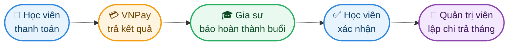
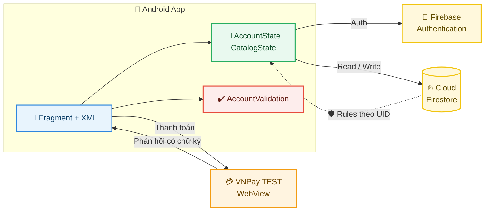

<div align="center">


<a href="https://github.com/pvhNam/TMDT_CK">
  
</a>

<br/>


**[🚀 Bắt đầu nhanh](#-bắt-đầu-nhanh) · [✨ Tính năng](#-tính-năng) · [🏗️ Kiến trúc](#️-kiến-trúc) · [⚙️ Cấu hình](#️-cấu-hình-môi-trường) · [🤝 Phát triển](#-quy-trình-phát-triển) · [🩺 Sự cố](#-xử-lý-sự-cố)**

</div>

<br/>

> [!NOTE]
> TMDT là ứng dụng Android cho **học viên** và **gia sư**. Giao diện theo thiết kế Figma (`thiết kế giao diện mobile_1.docx`); dữ liệu rút gọn từ `03_Thiet_ke_CSDL_v4.md`, chỉ giữ các luồng nghiệp vụ đang dùng.

---

## 📚 Mục lục

<table>
<tr>
<td>

1. [✨ Tính năng](#-tính-năng)
2. [👥 Vai trò](#-vai-trò-người-dùng)
3. [🏗️ Kiến trúc](#️-kiến-trúc)
4. [🚀 Bắt đầu nhanh](#-bắt-đầu-nhanh)

</td>
<td>

5. [⚙️ Cấu hình môi trường](#️-cấu-hình-môi-trường)
6. [🤝 Quy trình phát triển](#-quy-trình-phát-triển)
7. [🧪 Kiểm thử](#-kiểm-thử)
8. [🔐 Bảo mật](#-bảo-mật)

</td>
<td>

9. [🩺 Xử lý sự cố](#-xử-lý-sự-cố)
10. [🗺️ Lộ trình](#️-lộ-trình)
11. [📖 Tài liệu](#-tài-liệu)
12. [💬 Liên hệ](#-đóng-góp-và-liên-hệ)

</td>
</tr>
</table>

---

## ✨ Tính năng

| | Hạng mục | Mô tả | Trạng thái |
| :-: | --- | --- | :-: |
| 🔑 | **Xác thực** | Email/Password, xác nhận mật khẩu, lưu phiên, quên mật khẩu qua email | ✅ Hoàn tất |
| 🏠 | **Trang chủ** | Banner, tìm kiếm không dấu, lọc theo môn, danh sách gia sư cập nhật thời gian thực | ✅ Hoàn tất |
| 👤 | **Hồ sơ cá nhân** | Thông tin, địa chỉ, số điện thoại, ảnh đại diện, cấp học, mục tiêu | ✅ Hoàn tất |
| 🎓 | **Đăng ký gia sư** | Nhập → xem lại → gửi; hồ sơ `PENDING` chờ duyệt; chuyển đổi vai trò | ✅ Hoàn tất |
| 💳 | **Thanh toán** | VNPay TEST trong WebView, chỉ ghi nhận khi phản hồi có chữ ký hợp lệ | ✅ Hoàn tất |
| 🛡️ | **Phân quyền dữ liệu** | Firestore Rules theo UID, chặn nâng quyền, chặn client sửa danh mục | ✅ Hoàn tất |
| 📱 | **Xác thực điện thoại** | OTP, chức năng bổ sung | ⚙️ Tùy chọn |
| 📅 | **Lịch học** | Màn hình chờ | 🚧 Đang phát triển |
| 💬 | **Tin nhắn** | Màn hình chờ | 🚧 Đang phát triển |

### 💸 Luồng thanh toán



<details>
<summary><b>🗑️ Đã loại bỏ khỏi phạm vi (bấm để xem)</b></summary>

<br/>

Tin đăng / ứng tuyển / lời mời · minh chứng bằng cấp · hợp đồng chống dạy ngoài · học thử / điểm danh · đánh giá · cấu hình hệ thống.

Chi tiết: [FIRESTORE_SCHEMA.md](FIRESTORE_SCHEMA.md)

</details>

## 👥 Vai trò người dùng

| Vai trò | Có thể làm gì |
| :-: | --- |
| 🎒 **Học viên** | Tìm kiếm không dấu, lọc theo môn, xem hồ sơ gia sư, quản lý hồ sơ cá nhân, thanh toán học phí |
| 🎓 **Gia sư** | Đăng ký hồ sơ gia sư, chờ duyệt, chuyển đổi vai trò, báo hoàn thành buổi học |
| 🛠️ **Quản trị viên** | Duyệt hồ sơ gia sư, quản lý danh mục gia sư/môn dạy, lập bảng chi trả theo tháng |

## 🏗️ Kiến trúc



### 🧰 Công nghệ

<div align="center">


</div>

| Lớp | Công nghệ |
| --- | --- |
| 📱 Client | Android (Java), Fragment + XML, minSdk Android 10 |
| 🔨 Build | Gradle (Kotlin DSL), JDK 21 |
| 🔑 Xác thực | Firebase Authentication |
| 🔥 Dữ liệu | Cloud Firestore + Security Rules |
| 💳 Thanh toán | VNPay TEST |
| 🧪 Tooling | Firebase Emulator, Node.js scripts |

### 📁 Cấu trúc repository

```text
.
├── 📱 app/                      Mã nguồn ứng dụng Android
├── ✉️  email-otp-server/         Máy chủ hỗ trợ gửi OTP qua email
├── 🧪 scripts/                  Kiểm thử Firebase, kiểm tra cấu hình VNPay
├── 🔏 signing/                  Cấu hình ký ứng dụng
├── 🗄️  legacy/                   Mã mô phỏng cũ (ngoài source set)
├── 🛡️  firestore.rules           Security Rules
├── 📇 firestore.indexes.json    Chỉ mục Firestore
├── 🔥 firebase.json             Cấu hình Firebase CLI / Emulator
└── 💳 vnpay.properties.example  Mẫu cấu hình VNPay
```

<details>
<summary><b>🧩 Thành phần mã nguồn chính (bấm để xem)</b></summary>

<br/>

| File | Trách nhiệm |
| --- | --- |
| `MainActivity.java` | Host Fragment, điều hướng, kiểm tra đăng nhập |
| `ui/home/HomeFragment.java` | Trang chủ (`fragment_home.xml`) |
| `ui/auth/*.java` | Đăng nhập, đăng ký, quên mật khẩu, OTP |
| `ui/profile/*.java` | Trang cá nhân, chỉnh sửa hồ sơ |
| `CatalogState.java` | Lắng nghe danh mục Firestore, nối môn và học phí |
| `AccountState.java` | Firebase Auth, lưu/tải hồ sơ, xử lý lỗi |
| `UserProfile.java` | Ánh xạ trường dữ liệu |
| `AccountValidation.java` | Kiểm tra và chuẩn hóa đầu vào |

Mỗi màn hình có Fragment và XML riêng — xem [SCREEN_STRUCTURE.md](SCREEN_STRUCTURE.md).

</details>

## 🚀 Bắt đầu nhanh

### 📋 Yêu cầu

| Công cụ | Phiên bản |
| --- | --- |
| 🤖 Android Studio | Bản ổn định mới |
| ☕ JDK | 21 |
| 📦 Android SDK | Theo cấu hình dự án |
| 📲 Thiết bị / máy ảo | Android 10 trở lên |
| 🟢 Node.js | Dùng cho script kiểm thử |

### ⬇️ Cài đặt

```bash
git clone https://github.com/pvhNam/TMDT_CK.git
cd TMDT_CK
```

1. Mở thư mục bằng Android Studio và đợi Gradle sync.
2. Hoàn tất [cấu hình Firebase](#-firebase).
3. Sao chép `vnpay.properties.example` thành `vnpay.properties`, điền thông tin TEST ([xem VNPay](#-vnpay-test)).
4. Chọn thiết bị và nhấn **Run** ▶️.

### 🔨 Build bằng dòng lệnh

```powershell
.\gradlew.bat :app:assembleDebug :app:testDebugUnitTest :app:lintDebug
```

📦 Đầu ra: `app/build/outputs/apk/debug/app-debug.apk`

## ⚙️ Cấu hình môi trường

### 🔥 Firebase

**Project:** `tmdt-3e274`

- [ ] Bật **Email/Password** trong Authentication
- [ ] **Publish Firestore Rules** từ `firestore.rules`
- [ ] Nhập danh mục gia sư và môn dạy theo [schema](FIRESTORE_SCHEMA.md)

> [!WARNING]
> `google-services.json` chỉ cấu hình ứng dụng. File này **không** đồng nghĩa rules đã được publish hoặc phương thức đăng nhập đã được bật trên Console.

Hồ sơ `users/{UID}` được tạo khi đăng ký thành công. Chi tiết: [FIREBASE_SETUP.md](FIREBASE_SETUP.md).

### 💳 VNPay TEST

Tạo `vnpay.properties` ở thư mục gốc (cùng cấp `gradlew.bat`):

```properties
VNPAY_TMN_CODE=MA_WEBSITE_TEST
VNPAY_HASH_SECRET=KHOA_CHECKSUM_TEST
VNPAY_RETURN_URL=https://tmdt.example/vnpay/return
```

Kiểm tra cấu hình (không in secret):

```bash
node scripts/check-vnpay-config.mjs
.\gradlew.bat :app:checkVnpayConfig :app:assembleDebug
```

| | Nguyên tắc | Nội dung |
| :-: | --- | --- |
| 🔗 | Return URL | WebView bắt trực tiếp trong app, không cần website hoạt động ở địa chỉ này |
| 🔄 | Thay đổi cấu hình | Cần build và cài lại ứng dụng |
| 🧾 | Dữ liệu giao dịch | Collection `sandbox_` lưu giao dịch từ cổng TEST, tách khỏi sổ tiền thật |
| 📦 | Bản release | Không chứa secret TEST, tắt nhánh ký trực tiếp trong app |

> [!CAUTION]
> `vnpay.properties` chứa khóa bí mật và đã được Git bỏ qua. **Tuyệt đối không commit** file này.

Chi tiết: [PAYMENT_SETUP.md](PAYMENT_SETUP.md).

## 🤝 Quy trình phát triển

> [!IMPORTANT]
> Các quy ước dưới đây là chuẩn làm việc đề xuất cho nhóm; điều chỉnh theo thực tế trước khi áp dụng.

### 🌿 Nhánh

| Nhánh | Mục đích |
| --- | --- |
| 🟢 `main` | Luôn ổn định, có thể build và chạy |
| ✨ `feature/<tên-ngắn>` | Phát triển tính năng mới |
| 🐞 `fix/<tên-ngắn>` | Sửa lỗi |
| 📝 `docs/<tên-ngắn>` | Cập nhật tài liệu |

### 📝 Commit

Theo [Conventional Commits](https://www.conventionalcommits.org/):

```text
feat(auth): thêm kiểm tra mật khẩu xác nhận
fix(home): sửa lọc theo môn khi không dấu
docs(readme): cập nhật hướng dẫn cấu hình VNPay
```

### 🔀 Pull Request

1. Tạo nhánh từ `main`, giữ thay đổi nhỏ và tập trung một mục tiêu.
2. Chạy `:app:testDebugUnitTest` và `:app:lintDebug` trước khi mở PR.
3. Mô tả rõ thay đổi, lý do, cách kiểm tra; đính kèm ảnh chụp màn hình nếu đổi giao diện.
4. Cần ít nhất một thành viên review và chấp thuận trước khi merge.
5. Thay đổi `firestore.rules` phải kèm kiểm thử trong `scripts/test-firebase.mjs`.

### 📐 Quy ước mã nguồn

- Mỗi màn hình một Fragment và một file XML riêng.
- Kiểm tra và chuẩn hóa đầu vào đặt trong `AccountValidation`, không rải trong Fragment.
- Truy cập dữ liệu và trạng thái tập trung ở lớp `*State`; Fragment chỉ xử lý hiển thị.
- Không thêm dữ liệu giả; trạng thái rỗng phải hiển thị đúng là rỗng.

## 🧪 Kiểm thử

| | Loại | Lệnh |
| :-: | --- | --- |
| ✅ | Unit test | `.\gradlew.bat :app:testDebugUnitTest` |
| 🔍 | Lint | `.\gradlew.bat :app:lintDebug` |
| 🛡️ | Auth và Rules | Firebase Emulator + `scripts/test-firebase.mjs` |

> [!TIP]
> Script kiểm thử chỉ dùng localhost và **không** ghi dữ liệu lên Firebase thật. OTP/SMS thật và email thật cần cấu hình Console và xác nhận riêng. Lệnh chạy Emulator: [FIREBASE_SETUP.md](FIREBASE_SETUP.md).

## 🔐 Bảo mật

- 🔒 Không commit `vnpay.properties`, khóa ký ứng dụng hoặc file chứa secret — các file này đã nằm trong `.gitignore`.
- 📤 Firestore Rules trong repository chỉ có hiệu lực sau khi được Publish trên Console.
- 🛡️ Rules bảo vệ hồ sơ theo UID, chặn nâng vai trò và chặn client sửa danh mục gia sư.
- 📮 Nếu phát hiện lỗ hổng, vui lòng báo riêng cho chủ repository thay vì mở issue công khai.

## 🩺 Xử lý sự cố

<details>
<summary><b>🔑 Không đăng nhập/đăng ký được</b></summary>

<br/>

**Nguyên nhân:** chưa bật Email/Password trên Console.
**Cách xử lý:** Firebase Console → Authentication → bật Email/Password.

</details>

<details>
<summary><b>🛡️ Báo thiếu quyền khi đọc/ghi dữ liệu</b></summary>

<br/>

**Nguyên nhân:** Rules chưa được Publish.
**Cách xử lý:** Publish `firestore.rules` lên Console.

</details>

<details>
<summary><b>🏠 Trang chủ trống</b></summary>

<br/>

**Nguyên nhân:** database chưa có gia sư/môn dạy (ứng dụng không hiển thị dữ liệu giả).
**Cách xử lý:** nhập dữ liệu theo [schema](FIRESTORE_SCHEMA.md).

</details>

<details>
<summary><b>⚙️ Build báo thiếu cấu hình VNPay</b></summary>

<br/>

**Nguyên nhân:** chưa có `vnpay.properties`.
**Cách xử lý:** sao chép từ `vnpay.properties.example` và điền thông tin TEST.

</details>

<details>
<summary><b>💳 VNPay trả mã 71 — terminal not approved</b></summary>

<br/>

**Nguyên nhân:** merchant TEST chưa được VNPay duyệt.
**Cách xử lý:** liên hệ VNPay kích hoạt. Không tự đánh dấu đơn thành công.

</details>

<details>
<summary><b>🔄 Đổi cấu hình VNPay nhưng không có hiệu lực</b></summary>

<br/>

**Nguyên nhân:** ứng dụng chưa được build lại.
**Cách xử lý:** build và cài lại ứng dụng.

</details>

## 🗺️ Lộ trình

- [x] 🏠 Trang chủ, đăng nhập, đăng ký, hồ sơ cá nhân
- [x] 🎓 Đăng ký làm gia sư và chuyển đổi vai trò
- [x] 💳 Thanh toán VNPay TEST
- [ ] 📅 Nghiệp vụ **Lịch học**
- [ ] 💬 Nghiệp vụ **Tin nhắn**

## 📖 Tài liệu

| | Tài liệu | Nội dung |
| :-: | --- | --- |
| 🔥 | [FIREBASE_SETUP.md](FIREBASE_SETUP.md) | Cấu hình Firebase và Emulator |
| 🗃️ | [FIRESTORE_SCHEMA.md](FIRESTORE_SCHEMA.md) | Schema Firestore rút gọn |
| 🎓 | [TUTOR_REGISTRATION.md](TUTOR_REGISTRATION.md) | Luồng đăng ký làm gia sư |
| 🎨 | [FIGMA_MENU.md](FIGMA_MENU.md) | Menu dưới theo Figma |
| 🧩 | [SCREEN_STRUCTURE.md](SCREEN_STRUCTURE.md) | Cấu trúc màn hình và Fragment |
| 💳 | [PAYMENT_SETUP.md](PAYMENT_SETUP.md) | Cấu hình thanh toán VNPay TEST |

## 💬 Đóng góp và liên hệ

Mọi đóng góp đều được hoan nghênh! Hãy đọc [Quy trình phát triển](#-quy-trình-phát-triển) trước khi mở Pull Request, và dùng [Issues](https://github.com/pvhNam/TMDT_CK/issues) để báo lỗi hoặc đề xuất tính năng.

<div align="center">

[](https://github.com/pvhNam)
[](https://github.com/pvhNam/TMDT_CK/graphs/contributors)
[](https://github.com/pvhNam/TMDT_CK/issues)

<br/>

⭐ Nếu thấy dự án hữu ích, hãy tặng một **star** nhé!


</div>
