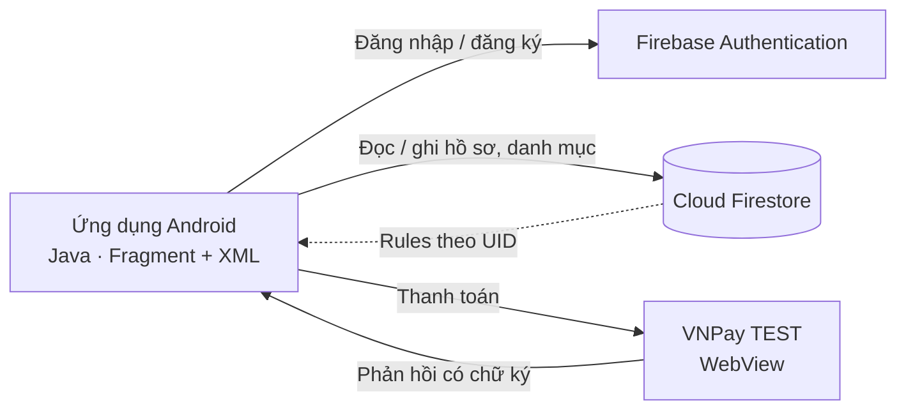

<div align="center">

# TMDT — Ứng dụng thuê gia sư

**Nền tảng Android kết nối học viên với gia sư, xây dựng trên Firebase và VNPay.**


[Tính năng](#tính-năng) · [Kiến trúc](#kiến-trúc) · [Bắt đầu](#bắt-đầu) · [Cấu hình](#cấu-hình) · [Kiểm thử](#kiểm-thử) · [Lộ trình](#lộ-trình)

</div>

---

## Giới thiệu

TMDT là ứng dụng di động giúp học viên tìm kiếm, đăng ký học với gia sư và thanh toán học phí ngay trong ứng dụng. Giao diện được triển khai theo thiết kế Figma (`thiết kế giao diện mobile_1.docx`); cấu trúc dữ liệu được rút gọn từ `03_Thiet_ke_CSDL_v4.md` để chỉ giữ lại các luồng nghiệp vụ đang sử dụng.

## Tính năng

| Nhóm | Mô tả | Trạng thái |
| --- | --- | :---: |
| **Xác thực** | Đăng ký, đăng nhập Email/Password, xác nhận mật khẩu, lưu phiên, quên mật khẩu qua email | ✅ |
| **Trang chủ** | Banner, tìm kiếm không dấu, lọc theo môn, danh sách gia sư đồng bộ thời gian thực từ Firestore | ✅ |
| **Hồ sơ cá nhân** | Xem/chỉnh sửa thông tin, địa chỉ, số điện thoại, ảnh đại diện, cấp học, mục tiêu; đăng xuất | ✅ |
| **Đăng ký làm gia sư** | Nhập thông tin → xem lại → gửi; chuyển đổi vai trò học viên/gia sư; hồ sơ `PENDING` chờ quản trị duyệt | ✅ |
| **Thanh toán** | VNPay TEST trong WebView, chỉ ghi nhận thành công khi có phản hồi hợp lệ kèm chữ ký | ✅ |
| **Phân quyền dữ liệu** | Firestore Rules theo UID, chặn nâng quyền và chặn client sửa danh mục gia sư | ✅ |
| **Xác thực điện thoại (OTP)** | Chức năng bổ sung, tùy chọn | ⚙️ Tùy chọn |
| **Lịch học** | Màn hình chờ, chưa kết nối nghiệp vụ | 🚧 |
| **Tin nhắn** | Màn hình chờ, chưa kết nối nghiệp vụ | 🚧 |

**Nghiệp vụ thanh toán:** học viên thanh toán đăng ký đã duyệt → VNPay trả kết quả → gia sư báo hoàn thành buổi học → học viên xác nhận → quản trị viên lập bảng chi trả theo tháng.

**Đã loại bỏ khỏi phạm vi các màn hình mới:** tin đăng/ứng tuyển/lời mời, minh chứng bằng cấp, hợp đồng chống dạy ngoài, học thử/điểm danh, đánh giá, cấu hình hệ thống. Xem [schema rút gọn](FIRESTORE_SCHEMA.md).

## Kiến trúc



**Công nghệ sử dụng**

| Thành phần | Công nghệ |
| --- | --- |
| Ứng dụng | Android (Java), Fragment + XML, Android 10 trở lên |
| Build | Gradle (Kotlin DSL), JDK 21 |
| Xác thực | Firebase Authentication |
| Cơ sở dữ liệu | Cloud Firestore |
| Thanh toán | VNPay TEST |
| Kiểm thử | Firebase Emulator, Node.js scripts |

**Cấu trúc thư mục**

```text
.
├── app/                    Mã nguồn ứng dụng Android
├── email-otp-server/       Máy chủ hỗ trợ gửi OTP qua email
├── scripts/                Kiểm thử Firebase, kiểm tra cấu hình VNPay
├── signing/                Cấu hình ký ứng dụng
├── legacy/                 Mã mô phỏng cũ (ngoài source set)
├── firestore.rules         Phân quyền Firestore
├── firestore.indexes.json  Chỉ mục Firestore
├── firebase.json           Cấu hình Firebase CLI / Emulator
└── vnpay.properties.example  Mẫu cấu hình VNPay
```

**Mã nguồn chính**

| File | Chức năng |
| --- | --- |
| `MainActivity.java` | Host Fragment, điều hướng, kiểm tra đăng nhập |
| `ui/home/HomeFragment.java` | Trang chủ (`fragment_home.xml`) |
| `ui/auth/*.java` | Đăng nhập, đăng ký, quên mật khẩu, OTP |
| `ui/profile/*.java` | Trang cá nhân, chỉnh sửa hồ sơ |
| `CatalogState.java` | Lắng nghe danh mục Firestore, nối môn và học phí |
| `AccountState.java` | Firebase Auth, lưu/tải hồ sơ, xử lý lỗi |
| `UserProfile.java` | Ánh xạ trường dữ liệu |
| `AccountValidation.java` | Kiểm tra và chuẩn hóa đầu vào |
| `scripts/test-firebase.mjs` | Kiểm thử Auth/rules trên localhost |

Chi tiết màn hình: [SCREEN_STRUCTURE.md](SCREEN_STRUCTURE.md).

## Bắt đầu

### Yêu cầu

- Android Studio, JDK 21, Android SDK theo cấu hình dự án
- Thiết bị hoặc máy ảo Android 10 trở lên
- Node.js (chạy script kiểm thử)

### Cài đặt

```bash
git clone https://github.com/pvhNam/TMDT_CK.git
cd TMDT_CK
```

1. Mở thư mục bằng Android Studio.
2. Hoàn tất [cấu hình Firebase](#firebase).
3. Sao chép `vnpay.properties.example` thành `vnpay.properties` và điền thông tin TEST ([xem VNPay](#vnpay-test)).
4. Chọn thiết bị và chạy ứng dụng.

### Build bằng dòng lệnh

```powershell
.\gradlew.bat :app:assembleDebug :app:testDebugUnitTest :app:lintDebug
```

APK debug: `app/build/outputs/apk/debug/app-debug.apk`

## Cấu hình

### Firebase

Project: `tmdt-3e274`

- [ ] Bật phương thức đăng nhập **Email/Password** trên Firebase Console.
- [ ] **Publish Firestore Rules** trên Console.
- [ ] Quản trị viên nhập danh mục gia sư và môn dạy theo [schema](FIRESTORE_SCHEMA.md).

> **Lưu ý:** `google-services.json` chỉ cấu hình ứng dụng. File này không đồng nghĩa rules đã được publish hoặc phương thức đăng nhập đã được bật.

Dữ liệu `users/{UID}` được tạo khi đăng ký thành công. Hướng dẫn đầy đủ: [FIREBASE_SETUP.md](FIREBASE_SETUP.md).

### VNPay TEST

Tạo `vnpay.properties` ở thư mục gốc (cùng cấp `gradlew.bat`):

```properties
VNPAY_TMN_CODE=MA_WEBSITE_TEST
VNPAY_HASH_SECRET=KHOA_CHECKSUM_TEST
VNPAY_RETURN_URL=https://tmdt.example/vnpay/return
```

Kiểm tra cấu hình (không in secret):

```bash
node scripts/check-vnpay-config.mjs
.\gradlew.bat :app:checkVnpayConfig :app:assembleDebug
```

- `VNPAY_RETURN_URL` được WebView bắt trực tiếp trong ứng dụng, không cần website hoạt động ở địa chỉ này.
- Đổi cấu hình thì cần build và cài lại ứng dụng.
- Các collection `sandbox_` lưu giao dịch từ cổng VNPay TEST, tách biệt với sổ tiền thật.
- Mã lỗi **71 — The terminal (website) not approved**: cần VNPay duyệt merchant TEST; không tự đánh dấu đơn thành công.
- Bản release không chứa secret TEST và tắt nhánh ký trực tiếp trong ứng dụng.

Chi tiết: [PAYMENT_SETUP.md](PAYMENT_SETUP.md).

## Kiểm thử

| Loại | Lệnh / cách chạy |
| --- | --- |
| Unit test | `.\gradlew.bat :app:testDebugUnitTest` |
| Lint | `.\gradlew.bat :app:lintDebug` |
| Auth & Rules | Firebase Emulator + `scripts/test-firebase.mjs` (chỉ chạy localhost, không ghi lên Firebase thật) |

OTP/SMS thật và email thật cần cấu hình Console và xác nhận riêng. Lệnh chạy Emulator xem trong [FIREBASE_SETUP.md](FIREBASE_SETUP.md).

## Lộ trình

- [x] Trang chủ, đăng nhập, đăng ký, hồ sơ cá nhân
- [x] Đăng ký làm gia sư và chuyển đổi vai trò
- [x] Thanh toán VNPay TEST
- [ ] Kết nối nghiệp vụ **Lịch học**
- [ ] Kết nối nghiệp vụ **Tin nhắn**

## Tài liệu

| Tài liệu | Nội dung |
| --- | --- |
| [FIREBASE_SETUP.md](FIREBASE_SETUP.md) | Cấu hình Firebase và Emulator |
| [FIRESTORE_SCHEMA.md](FIRESTORE_SCHEMA.md) | Schema Firestore rút gọn |
| [TUTOR_REGISTRATION.md](TUTOR_REGISTRATION.md) | Luồng đăng ký làm gia sư |
| [FIGMA_MENU.md](FIGMA_MENU.md) | Menu dưới theo Figma |
| [SCREEN_STRUCTURE.md](SCREEN_STRUCTURE.md) | Cấu trúc màn hình và Fragment |
| [PAYMENT_SETUP.md](PAYMENT_SETUP.md) | Cấu hình thanh toán VNPay TEST |

## Bảo mật

Không commit `vnpay.properties`, khóa ký ứng dụng hoặc bất kỳ file nào chứa secret. Firestore Rules trong repository chỉ có hiệu lực sau khi được Publish trên Firebase Console.

---

<div align="center">

Phát triển bởi [pvhNam](https://github.com/pvhNam)

</div>
